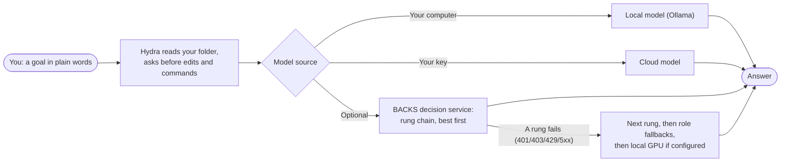

# Hydra

**Turn a task into working code, with the models you choose.**

Hydra is a coding agent for your terminal. Give it a repository and a goal. It can read the tree, edit files, run commands you approve, and keep notes for later sessions. Run a model on your own machine, send work to a service you configure, or use both.

**Created by Cuzzo (Tcuzzo) with BACKS AIOS.** Models and coding assistants are tools used within AIOS. [Project and skill credits](PROVENANCE.md#project-and-tool-credit).

Python 3.11+ · Linux, macOS, Windows · [MIT](LICENSE.md)

## What Hydra is

- Explores a codebase, makes the change you asked for, and runs the checks you approve.
- Keeps filesystem tools inside the working directory, or an explicit `--root`.
- Lets you pick the model and the provider. A family name does not select an API.
- Can remember project lessons, watch files, and run a bounded specialist team.

A useful answer depends on the model you select and the tools installed on the machine. Hydra does not ship API keys.

## How it works



New to this? [How Hydra works, in plain English](docs/HOW_HYDRA_WORKS.md) explains what Hydra needs, what each placeholder such as `<backs-host>` means and where to set it, and what happens when a model fails, with flow charts.

## Install

Install the CLI with [pipx](https://pipx.pypa.io/):

```bash
pipx install git+https://github.com/Tcuzzo/HydraAgent_public.git
```

Open a terminal in the project you want to work on, then run:

```bash
hydra
```

On first launch, connect a local model, a cloud API key, or the Codex CLI sign-in path. `hydra setup` walks the same choices from the command line. Provider settings are stored outside the project, under `~/.hydraAgent/workspace/`.

From a clone, use the steps in [Develop from source](QUICKSTART.md#develop-from-source).

## First task

Install [Ollama](https://ollama.com), start it, and pull a model that fits your machine. Replace `<your-model>` before you run the commands. The quotes keep the placeholder from being read as shell redirection.

```bash
ollama pull '<your-model>'
hydra setup --mode local --model '<your-model>' --non-interactive
hydra ask "Explain this project's entry point" --provider ollama --model '<your-model>' --approval-policy deny
```

`deny` lets Hydra read and explain without editing or running shell commands. `hydra models --provider ollama` lists what that server is serving. Required pieces, optional pieces, and which test skips are expected are in [What you need](QUICKSTART.md#what-you-need).

## Safety

The default `ask` policy prompts before shell commands and file changes. Noninteractive runs refuse those actions unless you pass `--approval-policy allow`. Use `deny` for inspection.

```bash
hydra ask "Review the error handling" --root ./my-project --approval-policy deny
hydra undo --list
```

Approval is not an operating-system sandbox. A shell command can affect more than the workspace. `undo` restores saved file edits and cannot reverse external side effects.

Worker verification that asks for a sandbox runs the command only inside Linux Bubblewrap. When confinement is unavailable, including on native Windows and macOS, it returns `bwrap sandbox unavailable` and does not run the command. See [how to enable the sandbox](QUICKSTART.md#sandbox-bubblewrap).

`hydra ask` exits nonzero when it fails or exhausts its iteration budget, and it still prints any partial result. `--max-iterations` limits model turns. `--timeout` limits each model call.

## Optional capabilities

Hydra runs without any of these. Each one is a separate install or setting. What it is, the switch the code reads, and a check are in [Optional capabilities and how to enable them](QUICKSTART.md#optional-capabilities-and-how-to-enable-them).

| Capability | What it adds |
|---|---|
| Local models (Ollama) | Chat and coding on a server you run |
| Needle / Kev and a fleet ladder | Tool selection, and a decision service at `http://<backs-host>:<port>` (`HYDRA_BACKS_URL`; there is no `hydra setup --mode backs`) |
| Sandbox (Bubblewrap) | Confined worker verification on Linux |
| MCP | Hydra tools over stdio, or servers you list in a config file |
| Memory embeddings | Vector recall next to keyword search |

## Links

| Need | Start here |
|---|---|
| What Hydra needs and how it works, in plain English | [How Hydra works](docs/HOW_HYDRA_WORKS.md) |
| Install, first task, and optional setup | [Quickstart](QUICKSTART.md) |
| Commands | [Command reference](docs/CLI-REFERENCE.md) |
| Providers, Needle, and Laya | [Models](docs/MODELS.md) |
| Local runtime, index, and embeddings | [Run Hydra on your own machine](docs/LOCAL-AGNOSTIC-RUNTIME.md) |
| Specialist teams and MCP | [Personal orchestration](docs/PERSONAL-ORCHESTRATION.md) |
| Train local navigation helpers | [Training](docs/TRAINING.md) |
| Platform differences | [Platform notes](docs/PLATFORM-NOTES.md) |
| Full-stack skills | [Full-stack workflow](docs/FULLSTACK-WORKFLOW.md) |
| Report a vulnerability | [Security policy](SECURITY.md) |
| Origins and third-party notices | [PROVENANCE.md](PROVENANCE.md) · [NOTICE.md](NOTICE.md) |
