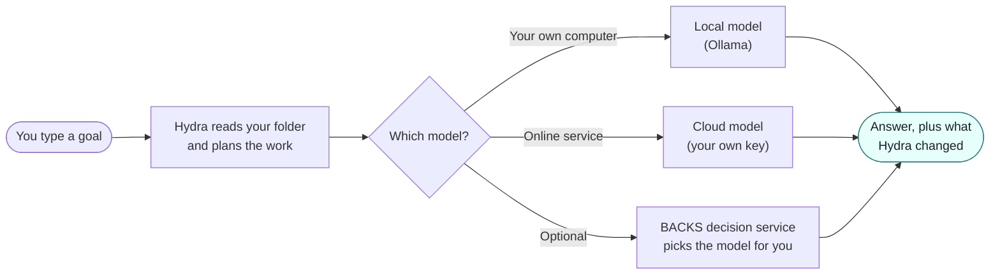
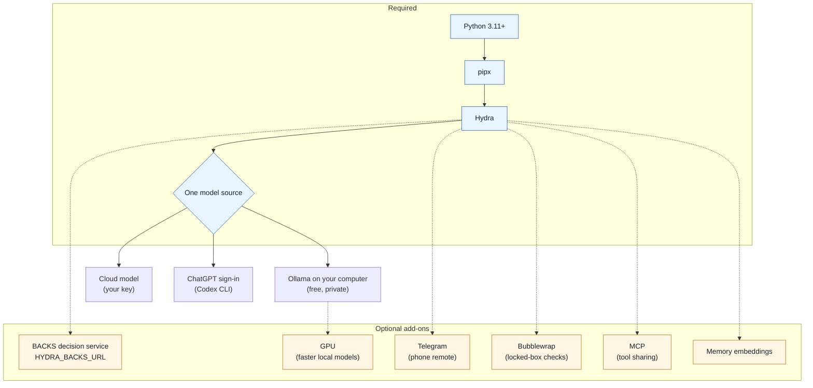
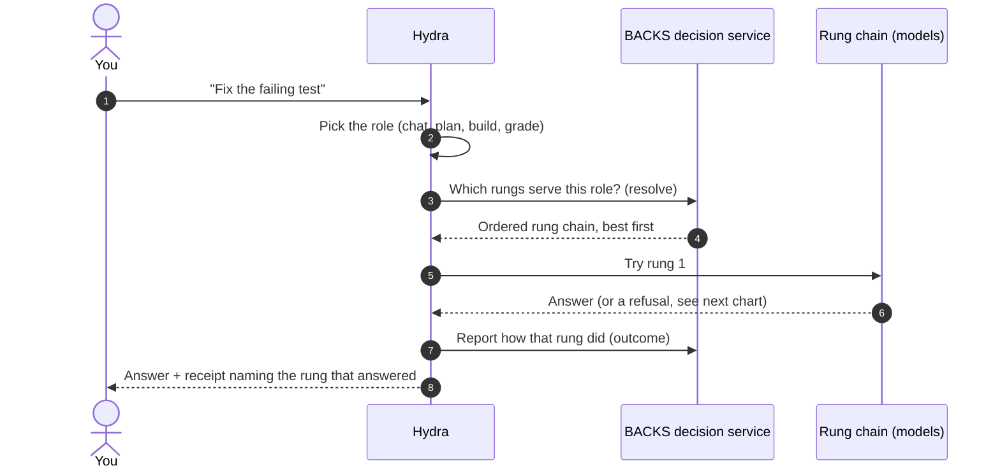
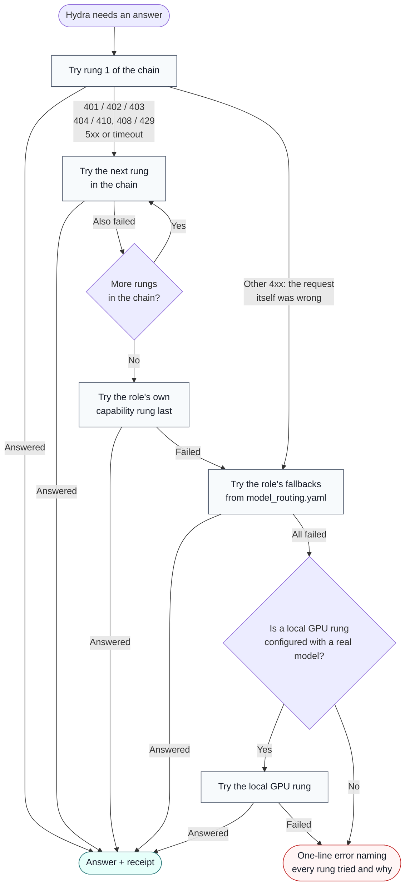

# How Hydra works (plain English)

This page is for anyone, engineer or not. It explains what Hydra is, what it needs to run,
what every placeholder in these docs means, and what happens when a model is unavailable.
Words in **bold** are explained the first time they appear.

## What Hydra is

Hydra is a helper you run in a terminal (the text window where you type commands). You give it
a folder of code and a goal in plain words, such as "explain how login works" or "fix the failing
test". Hydra reads the files, decides what to do, asks your permission before it changes anything
or runs a command, and then tells you what it did.

Hydra does not contain an AI model itself. A **model** is the AI service that writes the answers,
for example one running on your own computer or one you pay for online. Hydra is the part that
reads your files, keeps the model inside the rules, and keeps a record.

## The short version



## What you need

### Required

| What | Why | How to check |
|---|---|---|
| **Python** 3.11 or newer | Hydra is written in Python, a programming language. Your computer needs it installed to run Hydra. | `python3 --version` |
| **pipx** | A small installer that puts Hydra in its own private space so it cannot break other programs. | `pipx --version` |
| One model source | Something has to write the answers. Pick one: a local model, a cloud key, or the ChatGPT sign-in through the Codex CLI. | `hydra setup` walks you through it |

Install with one command:

```bash
pipx install git+https://github.com/Tcuzzo/HydraAgent_public.git
```

### Optional

Hydra runs without any of these. Each one adds a capability.

| What | What it adds | Where you turn it on |
|---|---|---|
| **Ollama** (a free program that runs models on your own computer) | Private, offline answers. Nothing leaves your machine. | Install from [ollama.com](https://ollama.com). Hydra looks at `http://localhost:11434` unless you set `OLLAMA_ENDPOINT`. |
| A **GPU** (graphics card) | Makes local models fast. Without one, local models still work, only slower. | Nothing to set. Ollama uses it automatically. |
| A cloud model key | Answers from a paid online model. | `hydra setup --mode cloud`. Keys are stored under `~/.hydraAgent/workspace/`, never in your project. |
| The **BACKS decision service** (also called the router or Kev/Needle) | A separate server you run that picks the best available model for each job, and switches to another one when a model fails. Hydra does not ship this server. | `HYDRA_BACKS_URL` (see placeholders below). |
| **Telegram** (a chat app) | Talk to Hydra from your phone. | `HYDRA_TELEGRAM_BOT_TOKEN` and `HYDRA_OPERATOR_DM_CHAT_ID` in your environment. |
| **Bubblewrap** (a Linux tool that fences a program in) | Lets Hydra run checks in a locked box on Linux. | `sudo apt-get install bubblewrap` |
| **MCP** (a standard way for AI tools to talk to each other) | Lets other tools use Hydra, and Hydra use them. | `pip install "hydraagent[mcp]"` |
| Memory embeddings | Lets Hydra find past notes by meaning, not only by exact words. | `pip install "hydraagent[memory]"` plus Ollama |

The full list, with the exact check for each, is in
[Optional capabilities](../QUICKSTART.md#optional-capabilities-and-how-to-enable-them).

### How the pieces fit together



Solid lines are required. Dotted lines are optional.

## Placeholders: what they mean and where to set them

These docs never show anyone's real computer names, network addresses, user names or keys.
Wherever you would type your own value, you see a **placeholder** in angle brackets, like
`<backs-host>`. Replace the whole thing, brackets included, with your value. In a terminal,
keep quotes around it so the brackets are not read as special characters.

| Placeholder | What it means | Where you set it |
|---|---|---|
| `<your-model>` | The name of a model you installed or pay for. | On the command line (`--model '<your-model>'`), or in `hydra setup`. |
| `<provider>`, `<model>`, `<family>` | Who serves a model, its name, and its maker. Used per role (planner, doer, worker, auditor). | `.hydraAgent/hydra.yaml`, copied from [`.hydraAgent/hydra.example.yaml`](../.hydraAgent/hydra.example.yaml). That file stays out of git. |
| `<base-url>`, `<key-env>` | The web address of a model service, and the *name* of the environment variable that holds its key (not the key itself). | Same `hydra.yaml`. |
| `<backs-host>` | The name or network address of the computer running your BACKS decision service. Examples: `localhost` if it is the same computer, or your server's address on your home network. | `HYDRA_BACKS_URL`, or `BACKS_ENDPOINT` in `~/.hydraAgent/workspace/.env.backs`. |
| `<port>` | The "door number" that service listens on. Your BACKS setup tells you which one. | Part of the same URL: `http://<backs-host>:<port>`. |
| `<needle-url>` | The same decision service address, when a doc talks about the Needle part of it. | Same as above. |
| `<YOUR_USER>` | Your login name on your computer. | Nowhere. Hydra uses `~` (your home folder) so it never needs it. |
| `<BACKS_DEPLOY_ROOT>` | The folder that holds your own BACKS deployment, used by some vendored skills. | Your own machine's notes or environment. Never commit it. |
| `<camera-mac-N>`, `<camera-lan-host-N>` | A camera's hardware address and its address on your home network, in the camera-inventory skill. | Filled from your own cameras' live data. Never commit real values. |

An **environment variable** is a named setting your terminal passes to programs. You set one for
the current terminal like this:

```bash
export HYDRA_BACKS_URL='http://<backs-host>:<port>'
```

Rules Hydra keeps:

- **No hard-coded hosts, models or keys.** The code reads every address from the environment or
  a config file. Model names come from the role file or from the BACKS decision service, never
  from Hydra's source code. `hydra/model_routing.yaml` names only **rungs** (see below).
- **Keys stay outside your project**, under `~/.hydraAgent/workspace/`.
- The test `hydra/test_public_scrub_guard.py` and the CI check `.github/scripts/ip-topology-scan.sh`
  fail if a real private address, device address, personal home folder or private machine name
  is committed.

## A request, step by step

A **role** is the kind of job: chatting, planning, building code, or grading work.
A **rung** is one step on a ladder of models for that role, best first. The BACKS decision
service owns the ladder; Hydra only names the rung it wants. A **receipt** is the short note
Hydra prints showing which rung actually answered.



Without the BACKS service, Hydra skips the middle step and talks to the model you configured
directly (your Ollama or your cloud key).

## When a model fails

Models fail for ordinary reasons: a key expired, credit ran out, a model was retired, a server
is busy. Hydra does not stop at the first failure. It works down the list and only gives up when
nothing on the list can answer, and then it tells you in one line what it tried.

What the codes mean:

- **401 / 403**: the key was refused (wrong, expired, or no credit left).
- **402**: payment required.
- **404 / 410**: that model is not available any more.
- **408 / 429**: too slow, or too many requests right now.
- **5xx** (500 and up): the service itself had a problem.



In order:

1. **The rung chain.** The BACKS service returns the rungs for this job, best first. Hydra tries
   each one. A refused key, missing credit, a retired model, a rate limit, a server error or a
   timeout moves it to the next rung. Every attempt is reported back to the service so it learns
   which rungs are healthy.
2. **The role's capability rung** is the last try inside the chain.
3. **Role fallbacks.** If `hydra ask` still has no answer, it walks the fallbacks listed for that
   role in `hydra/model_routing.yaml` (for example `chat: [cloud-doer, cloud-auto]`).
4. **Local GPU, only if configured.** If your setup has a local GPU rung *with a real model
   assigned*, Hydra tries it last. If not, Hydra skips it rather than pretend.
5. **One-line error.** If nothing answered, you see a single line such as
   `ask error: no rung answered: <rung>: 403; <rung>: 429; local GPU rung [not available]` and
   the command exits with code 1 (a signal to scripts that it failed). No long crash report.

Any other 4xx code means the request itself was the problem, so Hydra stops walking that chain
instead of sending the same bad request to every rung in it. `hydra ask` then goes to step 3.

Steps 1 to 5 describe Hydra once the rung-chain change in
[PR #54](https://github.com/Tcuzzo/HydraAgent_public/pull/54) is merged. Before that, tool
turns try only the role's capability rung, and `hydra ask` falls back straight to the local GPU.

## Where things live

| Location | What is there |
|---|---|
| Your project folder | Your code. Hydra's file tools stay inside it (or inside `--root`). |
| `.hydraAgent/hydra.yaml` | Optional role file: which provider and model each role uses. Not in git. |
| `~/.hydraAgent/workspace/` | Your provider settings and keys (`.env.*` files), outside any project. |
| `~/.hydra/hydra.yaml` or `$HYDRA_CONFIG` | Where the model router looks for the role file when no path is given. |
| `hydra/model_routing.yaml` | Shipped with Hydra. Names rungs and fallbacks only, no models or keys. |

## Words used on this page

| Word | Meaning |
|---|---|
| Terminal | The text window where you type commands. |
| Model | The AI service that writes answers. |
| Provider | Whoever serves the model: your own computer (Ollama) or a company. |
| Role | The kind of job: chat, plan, build, grade. |
| Rung | One model option on a ladder for a role, best first. |
| Fallback | The next option to try when one fails. |
| Receipt | The line Hydra prints naming which rung answered. |
| BACKS decision service | An optional server you run that owns the model ladder and keys. |
| Environment variable | A named setting your terminal passes to programs. |
| Placeholder | A `<name-in-brackets>` you replace with your own value. |
| GPU | A graphics card. It makes local models faster. |

More detail: [Quickstart](../QUICKSTART.md) · [Models](MODELS.md) ·
[BACKS router contract](BACKS_ROUTER_CONTRACT.md) · [Command reference](CLI-REFERENCE.md)
